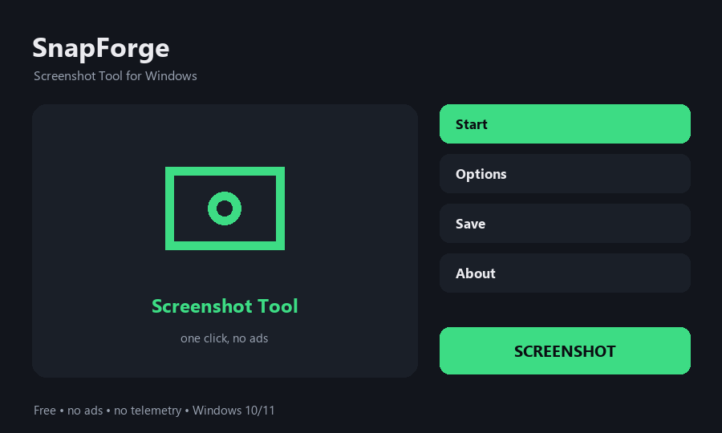

# SnapForge — Free Screenshot Tool for Windows

**Fast, free screenshot tool for Windows — full screen, window, or region.**

Print Screen gives you the whole screen and then you crop it by hand in Paint. **SnapForge skips that** — pick a region, a single window, or the full screen, and the shot lands straight into a PNG file and your clipboard, at the same time.

> A friendly **free screenshot tool for Windows 10 and 11** — region capture, window capture, full-screen capture, no watermark, no account, no trial.
> If you searched for a **snipping tool alternative**, a **screenshot utility**, a **screen capture app** or a **screen grab tool** — this is it.

> **Not affiliated with or endorsed by** Microsoft, ShareX, or Greenshot. Independent, clean-room implementation released under the MIT license.

---

## Who it's for

SnapForge is built for the **everyday Windows user** — bug reports, documentation screenshots, chat replies, forum posts, step-by-step guides, and anyone who wants a **tiny, no-nonsense screenshot utility** that doesn't ask for an account and doesn't phone home.

## Features

**Core**
- 📸 **Region, window, or full screen** — capture exactly what you need
- 📋 **Straight to a file *and* the clipboard** — no cropping in Paint afterwards
- 🚫 **No watermark** on the image, ever
- 📡 **Runs offline** — screenshots never leave your PC
- 🙅 **No account, no ads, no trial, no telemetry**
- 🧩 **Open source** — MIT licence

**What makes it nicer than the classics**
- Instant **PNG save** to a predictable folder — `Pictures\SnapForge\<date>.png`
- **Clipboard** gets the image at the exact same moment — paste into chat right away
- **Hotkey-first** workflow — one shortcut per capture mode, no menu to click through
- **Tiny** — runs on weak and old PCs, starts in a blink
- **Portable** — your captures live in your `Pictures` folder, easy to find, easy to clean
- Works on **Windows 10 and 11** (64-bit)

## Default mapping

| Shortcut | Action |
|---|---|
| PrintScreen | Full screen |
| Alt + PrintScreen | Active window |
| Ctrl + PrintScreen | Dragged region |
| Shift + PrintScreen | Save region without copying to clipboard |

## Install & use

1. Download `SnapForge.zip` from the [Releases](../../releases) page.
2. Extract the archive and run `SnapForge.msi` — the installer is small and finishes in a couple of seconds.
3. Press the shortcut, drag a region (or pick a window), and the shot lands in **Pictures\SnapForge\** and on your clipboard at the same time.
4. Optionally tick **Start with Windows** and **Minimize to tray**.

A small `.msi` installer, no runtime prerequisites, no internet. The `.msi` is unsigned, so on first launch Windows SmartScreen may warn — click **More info → Run anyway**.

## How it works

SnapForge **captures the pixels from the Windows desktop** using the standard GDI/Direct3D desktop-duplication APIs — no kernel driver, no screen-recording background service, no persistent connection to the internet. Each shot is encoded as a PNG and dropped on disk in your `Pictures` folder; the same bitmap is placed on the clipboard. That keeps it a plain, transparent desktop utility.

## How it's built

- **C# / .NET 8** WinForms (`net8.0-windows`, `win-x64`)
- **GDI / Direct3D desktop-duplication** via P/Invoke to `user32` / `d3d11`
- **Win32 clipboard API** for the "to clipboard" branch
- **Tray icon + global hotkeys** via `RegisterHotKey` (user32)
- The shipped product is a `.msi` installer

## License

MIT — see [LICENSE](LICENSE).

*Not affiliated with or endorsed by Microsoft, ShareX, Greenshot, or any other screenshot tool. All trademarks belong to their respective owners.*
